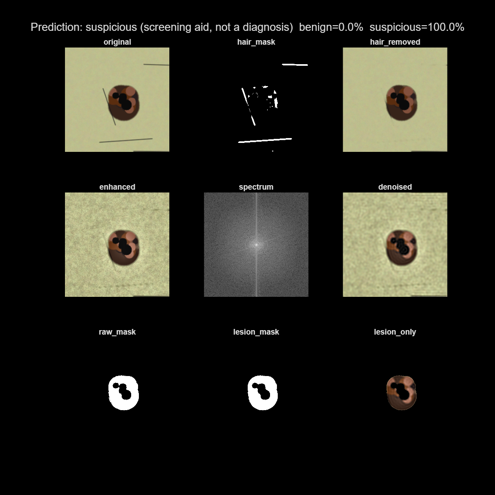

# Skin Lesion Classification Using DIP and Noise Ablation

**PES University | UE24EC342AC1 – Digital Image Processing | Team 24**

## Project Description

### Summary

This project implements a MATLAB-based Digital Image Processing (DIP) pipeline to classify skin lesion images as benign or suspicious.

The system performs hair removal, contrast enhancement, frequency-domain filtering, segmentation, and feature extraction before classification using machine learning.

A noise-ablation study evaluates the robustness of the pipeline under Gaussian and salt-and-pepper noise at different severity levels.

### Course Concepts Used

1. **Colour Models and Segmentation**
   - CIELAB colour space
   - Otsu thresholding
   - Connected-component analysis

2. **Frequency-Domain Processing**
   - 2-D Discrete Fourier Transform (DFT)
   - Centered frequency spectrum
   - Circular low-pass filtering
   - Inverse DFT

3. **Image Enhancement**
   - Contrast Limited Adaptive Histogram Equalization (CLAHE)
   - Unsharp masking
   - Local contrast enhancement

4. **Morphological Processing**
   - Black-hat transformation
   - Image inpainting
   - Morphological opening and closing

### Additional Concepts Used

1. **Feature Extraction**
   - Shape and asymmetry features
   - Colour features
   - GLCM texture features
   - DCT frequency features

2. **Machine Learning**
   - RBF Support Vector Machine (SVM)
   - Random Forest
   - Feature standardization

3. **Performance Evaluation**
   - Accuracy, Precision, Recall, F1 Score
   - Confusion Matrix
   - ROC-AUC
   - Noise-ablation analysis

### Dataset

The project uses 240 PNG images divided into two classes:

- Benign: 120 images
- Suspicious: 120 images
- Image resolution: 256 × 256 pixels

A stratified 75:25 train-test split is used:

- Training images: 180
- Testing images: 60
- Random seed: 42

Dataset folders:
- `data/benign/`
- `data/suspicious/`

### Novelty

1. Integration of all four DIP course units into a single skin lesion classification pipeline.
2. Extraction of 22 interpretable handcrafted features without using an end-to-end CNN.
3. Controlled noise-ablation experiments using Gaussian and salt-and-pepper noise with a fixed classifier and test dataset.

## Contributors

1. **Avaneesh Sai K (PES1UG24EC040)**
   - Image preprocessing and segmentation
   - Feature extraction
   - Classifier implementation
   - Noise-ablation analysis
   - Result interpretation

2. **Elliot Samuel Bhaskar (PES1UG24EC075)**
   - Dataset preparation
   - Pipeline integration
   - Testing and verification
   - Visualization of intermediate outputs
   - Classifier evaluation and documentation

## Steps

### Requirements

- MATLAB
- Image Processing Toolbox
- Statistics and Machine Learning Toolbox

### Clone the Repository

```bash
git clone https://github.com/DIP-2026-MINI-PROJECT/Skin-Lesion-Classification-Using-DIP-and-Noise-Ablation.git
```

### Run the MATLAB Demo

1. Open MATLAB.
2. Set the Current Folder to the `matlab` directory.
3. Run:

```matlab
pick_and_predict
```

4. Select an image from the `data/benign/` or `data/suspicious/` folder.
5. The program displays the processing stages and final classification.

### Predict a Specific Image

```matlab
predict_image(fullfile('..','data','suspicious','suspicious_0001.png'));
```

### Run Noise Ablation

```matlab
results = run_noise_ablation();
```

This evaluates the saved classifier under different Gaussian and salt-and-pepper noise conditions.

## Outputs

The pipeline generates:

1. Original RGB image
2. Hair detection mask
3. Hair-removed image
4. Contrast-enhanced image
5. Frequency spectrum
6. Frequency-filtered image
7. Initial segmentation mask
8. Refined lesion mask
9. Extracted lesion region
10. Final classification

### Classification Demo



### Classification Results

Both RBF-SVM and Random Forest achieved 100% accuracy on the fixed clean test set of 60 images.

### Noise-Ablation Results

| Noise Condition | Accuracy | F1 Score |
|---|---:|---:|
| Clean | 100.0% | 1.0000 |
| Gaussian (σ = 5) | 100.0% | 1.0000 |
| Gaussian (σ = 15) | 91.7% | 0.9231 |
| Gaussian (σ = 25) | 55.0% | 0.6824 |
| Salt-and-Pepper (1%) | 100.0% | 1.0000 |
| Salt-and-Pepper (5%) | 51.7% | 0.6742 |
| Salt-and-Pepper (10%) | 50.0% | 0.6667 |

Salt-and-pepper noise causes greater performance degradation than Gaussian noise at the tested severity levels.

Under high noise, the classifier increasingly predicts benign images as suspicious, reducing precision.

Additional graphs, confusion matrices, and experimental results are available in `outputs/` and `report_figs/`.

## References

1. [MathWorks Image Processing Toolbox](https://www.mathworks.com/help/images/)
2. [MathWorks Statistics and Machine Learning Toolbox](https://www.mathworks.com/help/stats/)

## Limitations and Future Work

### Limitations

- Small dataset of 240 images.
- No documented independent clinical dataset provenance.
- Clean-test accuracy does not guarantee clinical generalization.
- Significant degradation under medium and high noise.
- Not a clinically validated diagnostic system.

### Future Work

- Test on larger real-world skin lesion datasets.
- Validate predictions using expert-labelled clinical images.
- Improve preprocessing and noise robustness.
- Explore alternative classification methods.
- Perform independent external validation.
